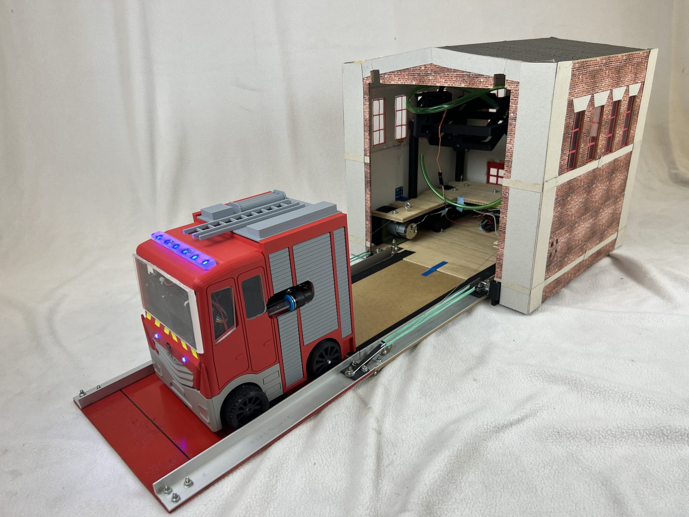
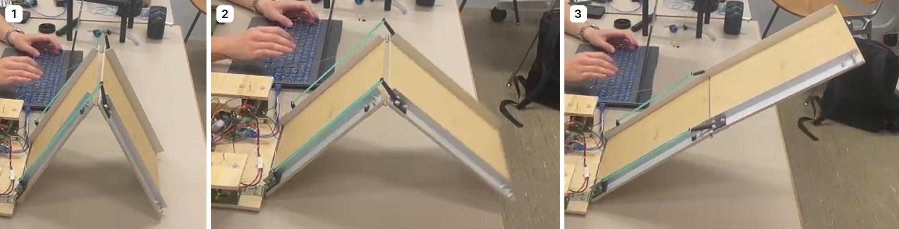
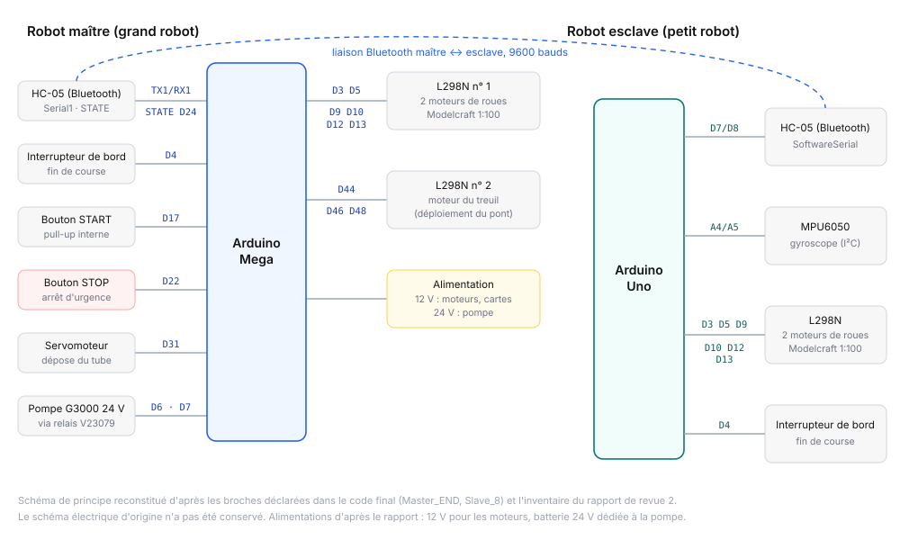
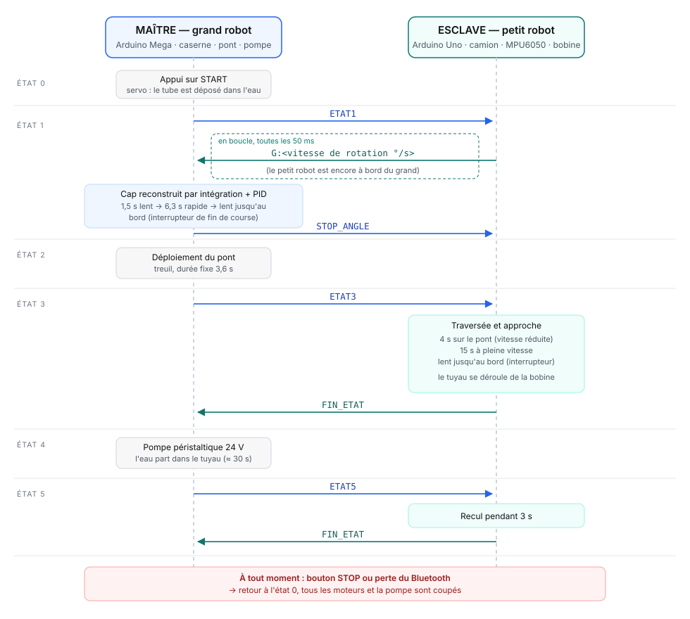

# Concours de robots HEPIA 2025 — équipe RVEZ (projet P2511)

Deux robots qui coopèrent en Bluetooth pour apporter de l'eau de l'autre côté d'un précipice : un **grand robot** (la caserne) transporte le **petit robot** (le camion de pompiers), déplie un pont, puis pompe l'eau dans le tuyau que le petit robot a déroulé jusqu'à la citerne.

Projet découverte de 1re année — HEPIA (HES-SO Genève), mars à juin 2025.
**Résultat : épreuve réussie et prix d'esthétisme.**



---

## La mission

| Élément | Valeur |
|---|---|
| Parcours | table de 3 m → vide de 50 cm → table de 3 m |
| Charge | ≈ 0,8 L d'eau à verser dans une citerne |
| Fin | une fois la citerne remplie, reculer de 50 cm et s'arrêter |
| Contraintes | entièrement autonome après le départ, budget de 200 CHF |

## L'équipe

| Membre | Rôle |
|---|---|
| Rémi Guerinet | Chef de projet |
| Lionel Karlen | Responsable mécanique |
| Mattéo Pozzo di Borgo | Responsable électronique, code des deux robots |
| Virgile Edinger | Responsable matériel et budget |
| Diogo Da Costa | Responsable communication, esthétique et bilan carbone |

## La stratégie

1. Le grand robot roule jusqu'au bord de la première table en transportant le petit robot.
2. Il déplie un **pont-levis** à deux plateaux au-dessus du vide.
3. Le petit robot traverse et roule jusqu'à la citerne en déroulant un **tuyau** depuis sa bobine.
4. Le grand robot active sa **pompe péristaltique 24 V** : l'eau de son réservoir part dans le tuyau jusqu'à la citerne.
5. Le petit robot recule.



## Électronique

| Fonction | Grand robot (maître) | Petit robot (esclave) |
|---|---|---|
| Carte | Arduino Mega | Arduino Uno |
| Bluetooth | HC-05 sur Serial1 + broche STATE | HC-05 en SoftwareSerial |
| Propulsion | 2 moteurs Modelcraft 1:100 + L298N | 2 moteurs Modelcraft 1:100 + L298N |
| Autres actionneurs | treuil du pont (2e L298N), pompe G3000 24 V (relais), servomoteur de dépose du tube | — |
| Capteurs | interrupteur de fin de course (bord), boutons START / STOP | gyroscope MPU6050, interrupteur de fin de course (bord) |



> Le schéma électrique d'origine n'a pas été conservé : ce schéma de principe est reconstitué d'après les broches déclarées dans le code final.

## Code

### Le gyroscope « prêté »

Le grand robot doit rouler droit sur 3 m, mais le seul gyroscope (MPU6050) est monté sur le petit robot… qui voyage justement à son bord pendant cette phase. Le petit robot envoie donc sa **vitesse de rotation** toutes les 50 ms (`G:<°/s>`) ; le grand robot l'**intègre** pour reconstruire son cap et corrige ses moteurs par **PID** :

```
correction = Kp·e + Ki·∫e dt + Kd·de/dt        (Kp = 6, Ki = 0,05, Kd = 0,6)
vitesse gauche = vitesse cible − correction
vitesse droite = vitesse cible + correction
```

### Machine à états et protocole



| Message | Envoyé par | Effet |
|---|---|---|
| `ETAT1` | Maître | L'esclave commence à envoyer sa vitesse de rotation |
| `G:<valeur>` | Esclave | Vitesse de rotation (°/s) pour le PID du maître |
| `STOP_ANGLE` | Maître | Bord atteint : fin de l'envoi |
| `ETAT3` | Maître | L'esclave traverse le pont et roule jusqu'au bord |
| `ETAT5` | Maître | L'esclave recule pendant 3 s |
| `FIN_ETAT` | Esclave | Accusé de réception : le maître passe à l'état suivant |

**Sécurités :** le bouton STOP ou la perte de la liaison Bluetooth (broche STATE du HC-05) ramènent le maître à l'état 0, tous les moteurs et la pompe coupés.

### Compiler et téléverser

1. **Arduino IDE**.
2. Bibliothèques : `Servo` et `SoftwareSerial` (incluses), **`MPU6050`** (Electronic Cats, gestionnaire de bibliothèques) pour le petit robot.
3. Grand robot : ouvrir `code/maitre/maitre.ino`, carte **Arduino Mega 2560**.
4. Petit robot : ouvrir `code/esclave/esclave.ino`, carte **Arduino Uno**.
5. Appairer les deux modules HC-05 (maître / esclave) à 9600 bauds.

L'**historique Git** retrace l'évolution réelle des deux programmes, du 19 mai au 26 juin 2025 (veille et jour du concours).

> Note : dans la dernière version conservée du code maître, `dureePompe` vaut 8 s ; le jour du concours, la pompe tournait en réalité environ 30 s (durée cohérente avec les essais ci-dessous).

### Brochage

| Signal | Maître (Mega) | Esclave (Uno) |
|---|---|---|
| L298N roues — ENA, ENB | D3, D5 | D3, D5 |
| L298N roues — IN1 à IN4 | D9, D10, D12, D13 | D9, D10, D12, D13 |
| L298N treuil — ENA, IN1, IN2 | D44, D46, D48 | — |
| Pompe | D6, D7 | — |
| Interrupteur de bord | D4 | D4 |
| Bluetooth | Serial1 (D18/D19), STATE D24 | D7 (RX), D8 (TX) |
| Boutons START / STOP | D17 / D22 | — |
| Servomoteur | D31 | — |
| MPU6050 (I²C) | — | A4 (SDA), A5 (SCL) |

## Dimensionnement et essais

**Pompe GROTHEN G3000** — réservoir de 750 mL, 3 m de tuyau :

| Tension | Temps de vidage | Débit moyen |
|---|---|---|
| 12 V | 60 s | 750 / 60 = 12,5 mL/s |
| 24 V | 30 s | 750 / 30 = 25 mL/s |

Pertes ≈ 30 mL, soit 4 % du volume (tolérance : 10 %). D'où une batterie 24 V dédiée à la pompe et un réservoir surélevé.

**Pont** — franchir 500 mm, porter 4 kg au maximum, tenir replié dans 400 × 400 × 100 mm. Deux plateaux en bois de 300 mm renforcés par des cornières aluminium, articulés par charnières, descendus par un treuil ; des élastiques déplient le second plateau.

**Moteurs de roues** (Modelcraft RB350100, 1:100) :
- couple continu C = 6 kgf·cm = 6 × 9,81 × 0,01 ≈ 0,589 N·m ;
- force motrice F = n·C / R = 2 × 0,589 / 0,06 ≈ 19,6 N ;
- résistance au roulement F_r = μr·m·g = 0,03 × 10 × 9,81 ≈ 2,94 N ;
- force nette ≈ 16,7 N, accélération ≈ 1,67 m/s² pour 10 kg ;
- vitesse à 52 tr/min : v = 52 / 60 × 2π × 0,06 ≈ 0,33 m/s, soit ≈ 9 s pour 3 m.

(Ce calcul corrige celui du rapport de revue 2, qui trouvait 3 N en mélangeant kgf et newtons ; la conclusion ne change pas.)

**Budget** — 240,60 CHF dépensés, dont 57,13 CHF de matériel réutilisable hors budget : 183,47 CHF comptés sur les 200 CHF autorisés.

## Contenu du dépôt

```
code/
  maitre/     Grand robot (Arduino Mega)
  esclave/    Petit robot (Arduino Uno)
  tests/      Programmes de test (gyroscope, servomoteur)
cao/          Pièces et assemblages Inventor, fichiers STL / 3MF, plans de la bobine
electronique/ Schéma de câblage reconstitué
docs/         Rapports et présentations des revues 1 et 2, planning, diagrammes
media/        Photos, rendus et vidéos
```

Le projet Inventor s'ouvre avec `cao/P2511_RVEZ.ipj` ; les assemblages principaux sont `robot_complet.iam`, `ASM_grand_Robot.iam` et `ASM_petit_Robot.iam`.

## Modèles tiers non inclus

Pour des raisons de licence, les modèles CAO de fabricants ne sont pas redistribués : moteurs Modelcraft, interrupteurs DM1, pompe péristaltique, roues omnidirectionnelles, roulements, raccords Festo, carte Arduino. Les assemblages qui les utilisent signaleront des références manquantes.

## Licence

- Code (`code/`) : **MIT**
- Conception, documents, images et vidéos : **CC BY-NC-SA 4.0**

Voir [`LICENSE`](LICENSE) et [`LICENSE-CC-BY-NC-SA-4.0.md`](LICENSE-CC-BY-NC-SA-4.0.md).

---

Portfolio de Mattéo Pozzo di Borgo : [p0770.github.io](https://p0770.github.io/projects/concours-robots)
